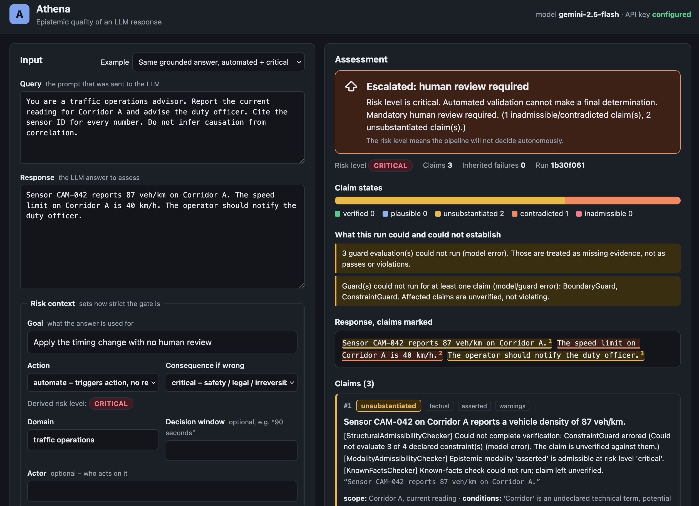

# Athena — Epistemic Validation Framework

> ## Status: v0.1.1 — read this first
>
> This README describes the **target design (spec v0.2)**. The code implements **v0.1**:
>
> | Stage | v0.1.1 reality |
> |---|---|
> | 0 Decompose | LLM decomposition. **No formalisation** into typed predicates. |
> | 1 Extract | LLM extraction; four claim types (**no `procedural`**). Structurally invalid claims are carried to the StructuralGuard and rejected, not dropped. |
> | 2 Classify | Deterministic type × modality check. |
> | 3 Guards | Structural (deterministic) + Constraint / Boundary / Terminology (**LLM call per claim per contract** — *not* "zero LLM calls"). An LLM outage yields an `errored` outcome, never a violation. |
> | 4 Admissibility | Structural + Modality checkers + your own. **Not implemented:** EpistemicFit, ModalAdmissible, Reliability, NormativeAdmissible checkers; UndercuttingDefeaterGuard; Stage 4.5 causal graph. |
> | 5 Resolve | Heuristic dependency builder (scope words + keyword negation) and failure propagator. |
> | 6 Gate | Risk-calibrated verdict. No claims extracted never yields a clean accept (escalates at high/critical). |
>
> **Planned, not built:** the eight v0.2 components above and the O(1) LLM-call budget. LLM calls currently grow with `claims × declared contracts`.
>
> Try it without an API key: `uv run python main.py`. Run the tests: `uv run pytest` (150 tests).
> `ValidationResult.pipeline_warnings` is always populated (claims excluded at extraction, guards that could not run, empty extraction).


## The core problem

A model can produce a grammatically perfect, contextually plausible, confidently stated sentence that is causally wrong, epistemically unjustified, or structurally inadmissible — and nothing in the output signals this. Existing guardrails frameworks check format and safety. They do not ask the harder question: **given what was asked, what was declared, and what is at stake — is this output epistemically admissible as input to a decision?**

---

## What Athena does

Athena takes four inputs:

```
prompt          — what was sent to the LLM
intent_context  — why this call was made, who acts on it, what the stakes are
domain_info     — constraints, boundaries, term definitions, known facts
llm_response    — what the LLM produced
```

It runs a six-stage pipeline and returns a structured verdict:
`accepted | accepted_with_warnings | rejected | escalated`

Every claim in the response is individually assessed and annotated. The verdict is risk-calibrated: a speculative claim is acceptable in a low-stakes informational context and inadmissible in a high-consequence automated system.

---

## The pipeline

```
Stage 0   Decompose prompt → extract implicit constraints, boundaries,
          term definitions, injected facts from raw prompt text
          Formalise constraints/boundaries into typed machine-checkable predicates

Stage 1   Extract claims from response → atomic, typed, traceable
          Each claim: factual | causal | predictive | normative | procedural
          Each modality: asserted | hedged | speculative | hypothetical

Stage 2   Classify — deterministic consistency check
          claim_type × epistemic_modality validity matrix

Stage 3   Guards — now fully deterministic, zero LLM calls
          StructuralGuard:          schema completeness per claim type
          BoundaryGuard:            formalised predicates, no LLM
          ConstraintGuard:          formalised predicates, no LLM
          TerminologyGuard:         embedding similarity, no LLM
          UndercuttingDefeaterGuard: correlational justification detection

Stage 4   Admissibility assessment
          StructuralAdmissibilityChecker:    from guard results
          ModalityAdmissibilityChecker:      modality × risk matrix
          EpistemicFitChecker:               temporal gap, domain fit
          ModalAdmissibilityChecker:         NLI entailment → verified/impossible
          ReliabilityChecker:                process reliability priors
          NormativeAdmissibilityChecker:     causal support, authority scope

Stage 4.5 Causal graph resolution
          One LLM call → CausalEntity + CausalEdge extraction
          Then deterministic:
            DAG validity check
            d-separation (Bayes Ball algorithm)
            Confounding detection (common causes)
            Collider identification (common effects)
            Mechanism completeness (causal gaps)
            Intervention consistency (normative ↔ causal)

Stage 5   Dependency resolution
          SCM-derived graph + failure propagation

Stage 6   Decision gate
          ActionClass × ConsequenceClass → RiskLevel → Verdict
```

---

## Epistemic foundations

Each component maps to a specific epistemological theory — not as decoration, but as the actual design rationale for that component's behaviour.

| Component | Theory | Core insight applied |
|---|---|---|
| `StructuralGuard` | Popperian falsifiability | Predictions without time horizons are unfalsifiable. Causal claims without mechanisms are unfalsifiable. Inadmissible. |
| `ConstraintGuard` | Formal verification | Pay LLM cost once to formalise natural language into typed predicates. Evaluate mechanically. |
| `BoundaryGuard` | Formal verification + Defeasibility | Boundaries are prohibitions. Epistemic prohibitions (no causation from correlation) are structurally checkable. |
| `UndercuttingDefeaterGuard` | Pollock's defeasibility theory | An undercutting defeater undermines the justification without contradicting the conclusion. Correlational assumptions do not justify causal conclusions. |
| `TerminologyGuard` | Terminological determinism | The prompt defines local semantics. Claims must be evaluated against declared definitions, not general language. Embedding similarity catches semantic drift. |
| `EpistemicFitChecker` | Plantinga's proper functionalism | An LLM's knowledge is frozen at training time. Claims about current/live states are outside its proper epistemic environment — temporal gap. |
| `ModalAdmissibilityChecker` | Hintikka's epistemic logic | A claim entailed by injected facts is true in all epistemically possible worlds consistent with the evidence. It is verified without external domain checker. |
| `ReliabilityChecker` | Goldman's reliabilism | Justification depends on whether the generating process tends to produce true beliefs in this context. Causal+asserted is systematically low reliability. |
| `NormativeAdmissibilityChecker` | Van Fraassen's constructive empiricism | Normative claims are prescriptions, not factual assertions. Assess against causal feasibility and authority scope, not truth. |
| `CausalGraphResolver` | Pearl's structural causal model | LLMs conflate observational correlation (Rung 1) with interventional causation (Rung 2). Make the causal structure explicit. Run d-separation, confounder detection, collider identification deterministically. |
| Risk matrix | Decision-theoretic risk control | Admissibility depends on the cost of error, not just likelihood. The same claim is acceptable at `inform/low` and inadmissible at `automate/critical`. |
| Dependency propagation | JTB + Gettier | An upstream inadmissible claim undermines downstream claims that depend on it. Failure propagates through the claim graph. |

---

## The five admissibility states

```
verified        — entailed by injected facts, or confirmed by domain checker
plausible       — structurally sound, consistent with evidence, reliable process
unsubstantiated — asserted without adequate justification or process reliability
contradicted    — conflicts with known facts, or boundary/constraint violation
inadmissible    — structurally invalid: missing mechanism, missing time horizon,
                  boundary violation, or process outside proper epistemic environment
```

These are not a spectrum. They are categorical epistemic distinctions.
`unsubstantiated` ≠ `contradicted`. One is absence of evidence. The other is evidence of absence.

---

## What Athena does not do

- It does not determine truth.
- It does not eliminate bias.
- It does not replace expert judgment.
- It does not validate long-term societal predictions.
- Its LLM-backed extraction stages (decompose, extract, formalise, causal) are themselves subject to hallucination — they extract structure, they do not validate it.

The causal reasoning checks, guard evaluations, and admissibility assessments run deterministically on the extracted structure. The quality of the pipeline is bounded by the quality of extraction.

---

## System invariants

Seven invariants are non-negotiable and enforced at every run:

1. No validation without declared intent
2. No prediction without time horizon
3. No causality without assumptions
4. No empirical scoring of normative claims
5. No scalar trust scores
6. No silent downgrades
7. False negatives preferred over false positives

---

## LLM call budget

```
v0.1:  2 + N × (constraints + boundaries + terms)   [O(N) per response]
v0.2:  4 fixed                                        [O(1) per response]

        Stage 0 decompose:  1
        Stage 0 formalise:  1  (one-time per unique prompt)
        Stage 1 extract:    1
        Stage 4.5 causal:   1  (one per response)
```

All guard evaluation, admissibility checking, causal reasoning, and decision logic runs deterministically after these four calls.

---

## References

- Popper, K. *The Logic of Scientific Discovery* (1959)
- Pearl, J. *Causality: Models, Reasoning, and Inference* (2000)
- Goldman, A. "What is Justified Belief?" (1979)
- Plantinga, A. *Warrant: The Current Debate* (1993)
- Hintikka, J. *Knowledge and Belief* (1962)
- Van Fraassen, B. *The Scientific Image* (1980)
- Pollock, J. *Contemporary Theories of Knowledge* (1986)
- Kahneman, D. & Tversky, A. "Judgment under Uncertainty" (1974)
- Mitchell, M. "Why AI Is Harder Than We Think" arXiv:2104.12871 (2021)

---

## Web test harness (`athena.web`)

The web UI ships **inside** the library as the optional `athena.web` subpackage:
one distribution, one version. Paste the **query** that was sent to a model and
the **response** it gave, set the risk context, and read the epistemic assessment
(verdict, per-claim state, guard results, dependencies).

```bash
uv sync --extra web              # or: pip install "kv-ai-athena-py[web]"
export GEMINI_API_KEY=...        # or GOOGLE_API_KEY, or put it in a .env file
uv run athena serve              # http://127.0.0.1:8000  (also: python -m athena.web)
```

`athena serve --host 0.0.0.0 --port 9000 --reload` are available. The core
library never imports `athena.web`, so `import athena` works without FastAPI.

| Variable | Default | Meaning |
|---|---|---|
| `GEMINI_API_KEY` / `GOOGLE_API_KEY` | none (required) | Read on the server only; never entered in the browser |
| `ATHENA_MODEL` | `gemini-2.5-flash` | Model used for decompose, extract, the three guards and the facts checker |
| `ATHENA_TIMEOUT_S` | `180` | Whole-run timeout |
| `ATHENA_MAX_CHARS` | `20000` | Per-field input limit |

What it adds on top of the pipeline:

* **`KnownFactsChecker`** (`athena/web/known_facts.py`). Athena ships no evidence
  source, so by itself a claim can only reach `plausible`. This checker lets a
  *factual* claim be `verified` (entailed by a fact you supplied) or `contradicted`
  (conflicts with one). It is LLM-judged, must cite a numbered fact, and an
  uncited verdict is downgraded to "no bearing". It verifies against **your**
  facts, not the world. It is registered by the web app only; library users add
  it (or their own checker) via `admissibility_checkers=[...]`.
* An "evidence notes" panel stating what the run could not establish (no facts
  supplied, guards that errored, no contract declared).

Caveats:

* Your query, response and facts are sent to the Gemini API. Run it locally;
  there is no authentication, and `athena serve` binds to 127.0.0.1 by default.
* One validation makes several model calls (decompose, extract, then guard and
  facts calls that scale with claims x declared constraints/boundaries). Expect
  seconds to a minute and per-call cost.
* The pipeline is exercised end to end offline (scripted model, and through
  pydantic-ai's Gemini model with the network call stubbed). It has not been run
  against the live Gemini service from the build environment.
